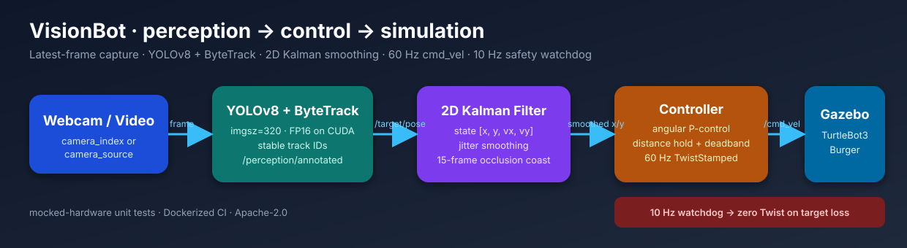

# VisionBot — Webcam-Driven Visual Teleoperation

A ROS 2 Jazzy perception-to-control stack that follows a person with a
simulated TurtleBot3 in Gazebo using only a webcam (or a recorded video).

[](https://docs.ros.org/en/jazzy/)
[](https://www.python.org/)
[](LICENSE)
[](https://github.com/KuNaL8103/VisionBot/actions/workflows/ros2_ci.yml)



## Quickstart — 5 commands

```bash
mkdir -p ~/ros2_ws/src && git clone https://github.com/KuNaL8103/VisionBot.git ~/ros2_ws/src
cd ~/ros2_ws && source /opt/ros/jazzy/setup.bash
pip install -r src/requirements.txt --break-system-packages
colcon build --symlink-install --packages-select visual_teleop_msgs visual_teleop && source install/setup.bash
export TURTLEBOT3_MODEL=burger && ros2 launch visual_teleop full_system.launch.py
```

Stand in front of the webcam. The simulated TurtleBot3 turns and holds a
configurable distance from you. On WSL 2, attach the webcam first — see
[docs/TROUBLESHOOTING.md](visual_teleop/docs/TROUBLESHOOTING.md).

---

## Why VisionBot

| Capability | Implementation |
| --- | --- |
| Detection + tracking | YOLOv8 (`imgsz=320`, FP16 on CUDA) + ByteTrack stable IDs |
| Smoothing + occlusion | Pure-NumPy constant-velocity 2D Kalman filter (`x, y, vx, vy`) |
| Low latency | Latest-frame capture thread, depth-1 QoS, 60 Hz `/cmd_vel` |
| Safety | 10 Hz watchdog publishes zero `TwistStamped` on target loss |
| Distance hold | Normalized bbox height as a pinhole distance proxy |
| Debugging | `/perception/annotated` with bbox, ID, FPS, inference time |
| Reproducible input | Webcam index **or** video file (`camera_source: "demo.mp4"`) |
| Quality | 38 mocked-hardware tests, flake8, Dockerized GitHub Actions CI |

## Data flow

```
Webcam / video
      │  latest-frame capture thread
      ▼
YOLOv8 + ByteTrack ──► /perception/annotated
      │
      ▼
2D Kalman filter (x, y, vx, vy)
      │  /target/pose  (TrackedTarget)
      ▼
Controller + 10 Hz watchdog
      │  /cmd_vel  (TwistStamped, 60 Hz)
      ▼
TurtleBot3 Burger in Gazebo
```

The controller turns toward the target's horizontal offset, holds
`target_distance` using bbox height, and stops immediately when the target is
not visible. `enable_safety_stop` and the watchdog guard against stale data.

## Project structure

```
.
├── Dockerfile                         # ROS 2 Jazzy CI/dev image
├── requirements.txt                   # Python runtime + lint/coverage deps
├── LICENSE                            # Apache-2.0
├── docs/images/architecture.svg       # data-flow diagram
├── scripts/record_demo.sh             # record docs/images/demo.gif
├── visual_teleop/                     # ament_python package
│   ├── visual_teleop/
│   │   ├── perception_node.py         # capture → YOLO → ByteTrack → Kalman
│   │   ├── controller_node.py         # target → distance hold + watchdog
│   │   └── utils/
│   │       ├── kalman_filter.py
│   │       └── tracker_wrapper.py
│   ├── launch/                        # perception / sim / full system
│   ├── config/params.yaml             # all tunables
│   ├── test/                          # 38 mocked-hardware tests
│   └── docs/                          # architecture, topics, troubleshooting
└── visual_teleop_msgs/                # TrackedTarget message
```

## Run pieces separately

```bash
# Gazebo + TurtleBot3 only
ros2 launch visual_teleop sim_turtlebot.launch.py

# Perception with parameters and debug window
ros2 run visual_teleop perception_node --ros-args \
  --params-file install/visual_teleop/share/visual_teleop/config/params.yaml \
  -p show_debug_window:=true

# Controller only
ros2 run visual_teleop controller_node
```

`ros2 run` does **not** load `config/params.yaml` automatically; use
`ros2 launch` or pass `--params-file`. Manual driving:

```bash
ros2 run turtlebot3_teleop teleop_keyboard
```

## Video-file demos

Set a file path in `config/params.yaml` to run without a camera:

```yaml
camera_source: "demo.mp4"   # overrides camera_index when non-empty
```

The capture thread plays the file at `camera_fps` and drops old frames just
like a webcam.

## Record a demo GIF

The script captures the current X11 display with `ffmpeg`, builds a palette,
scales to 960 px, and enforces a <10 MB GIF:

```bash
./scripts/record_demo.sh 12       # 12-second GIF → docs/images/demo.gif
```

Tune with `FPS=8 WIDTH=800 CAPTURE_SIZE=1280x720 ./scripts/record_demo.sh 10`.
Requires `ffmpeg`; X11 capture is used because WSLg exposes an X display.

## Configuration

All parameters are documented in
[docs/ARCHITECTURE.md](visual_teleop/docs/ARCHITECTURE.md). Common knobs:

| Parameter | Default | Purpose |
| --- | --- | --- |
| `camera_index` / `camera_source` | `0` / `""` | Webcam index or video path |
| `device` | `"auto"` | `cuda:0` when available, else `cpu` |
| `yolo_imgsz` | `320` | Inference resolution |
| `yolo_half` | `true` | FP16 (`quantize=16`) on CUDA only |
| `kalman_process_noise` | `0.1` | Higher = more responsive, less smooth |
| `kalman_measurement_noise` | `0.002` | Higher = smoother, more lag |
| `target_distance` | `1.0` | Desired follow distance (m) |
| `deadband` | `0.1` | Distance deadband (m) |
| `target_lost_timeout_sec` | `1.0` | Watchdog stop timeout |

Topic contracts and QoS are in [docs/TOPICS.md](visual_teleop/docs/TOPICS.md).

## Tests, lint, and CI

```bash
cd ~/ros2_ws
source install/setup.bash
python3 -m pytest src/visual_teleop/test/ -v
python3 -m flake8 --max-line-length=99 \
  src/visual_teleop/visual_teleop src/visual_teleop/test
```

All tests mock the camera, YOLO, and ByteTrack — no hardware or Gazebo needed.
Coverage includes Kalman smoothing/occlusion, annotated image publishing,
video-file selection, low-latency frame slots, stale timestamp rejection, and
bbox-height distance hold.

Docker:

```bash
docker build -t visionbot:jazzy .
docker run --rm visionbot:jazzy bash -lc \
  "source /opt/ros/jazzy/setup.bash && cd /ros2_ws && \
   colcon test --packages-select visual_teleop --python-testing pytest \
   --pytest-with-coverage --event-handlers console_direct+ && \
   colcon test-result --verbose"
```

GitHub Actions builds the image, runs `colcon build`, `flake8`, the headless
test suite with coverage, and `colcon test-result`.

## Documentation

- [Architecture and parameters](visual_teleop/docs/ARCHITECTURE.md)
- [Topic contracts and QoS](visual_teleop/docs/TOPICS.md)
- [Troubleshooting, WSL 2, Gazebo](visual_teleop/docs/TROUBLESHOOTING.md)

## Known limitations

- ByteTrack has no appearance ReID; `track_id` resets after a full occlusion.
- Single-target tracking: the highest-confidence person is followed.
- Simulation only; not validated on physical TurtleBot3 hardware.
- WSL 2 + Gazebo adds real latency; check the logged `Inference:` and
  `Latency:` lines before tuning.

## License

Apache-2.0 — see [LICENSE](LICENSE).
